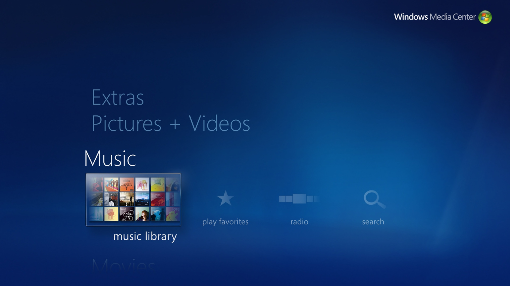
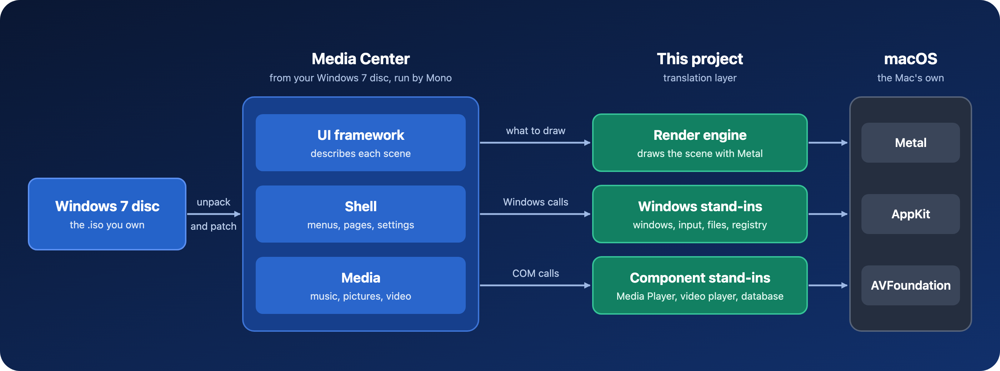

# Windows Media Center on macOS

<p align="center">
  
</p>

Take Windows Media Center from a Windows 7, Windows Vista or Windows XP
Media Center Edition 2005 disc image and make a Mac app of it that runs
natively on Apple silicon. It is your responsibility to have a legally-obtained copy of Windows 7 SP1 or Windows Vista SP2 (64-bit), or of Windows XP Media Center Edition 2005.

Apart from the screenshot above, nothing of Microsoft's is in this
repository, the installer or the tools.
Media Center comes from your disc image, and the app is made from it on
your Mac. What is here is original code.

## What works

Works:

- The launch animation and sound, the start menu, and every tile and
  Settings page.
- Music, Pictures and Videos libraries from your Mac's own folders, kept up
  to date while Media Center is open.
- Music with Now Playing, shuffle and repeat (including `.wma`), picture
  slide shows and the picture wall, and full-screen video with pause, seek
  and resume (`.mp4`, `.m4v`, `.mov`, `.wmv`, `.avi`).

Doesn't work yet:

- TV: no guide, recordings or live TV. Live TV, recording and protected
  content are out of scope.
- Visualizations (they relied on Windows Media Player), rewinding, and
  formats such as `.mkv`.
- Playlists last one session, and videos show "Unknown length".

On XP Media Center Edition 2005: the start menu and its sounds, My Music,
My Pictures (with slide shows) and My Videos from the same folders, music
and full-screen video, and the Settings pages. Online Spotlight and Help
(pages shown with Internet Explorer) don't open yet.

Tested with the English Windows 7 SP1 and Windows Vista SP2 discs (Home
Premium, 64-bit) and the English Windows XP Media Center Edition 2005 CD 2
on macOS 27. It is built for macOS 11 and later, but has not been run on macOS 11
yet; discs in other languages and Retina displays are untested.

## How it works

Media Center is mostly .NET code, which runs unchanged on Mono, natively on
arm64. Only its native half is replaced: the render engine is redrawn with
Metal, and the Windows functions Media Center calls are written anew for the
Mac. Windows Media and AVI files (`.wmv`, `.wma`, `.avi`) play through
FFmpeg's libraries (LGPL), built on your Mac with only those formats.

<p align="center">
  
</p>

## Make the app

You need an Apple silicon Mac with macOS 11 (Big Sur) or later and a disc
image (`.iso`) with Media Center: a 64-bit Windows 7 Home Premium,
Professional, Ultimate or Enterprise, a 64-bit Windows Vista Home Premium
or Ultimate, or the second CD of Windows XP Media Center Edition 2005.

**With the installer:** download **Media Center Installer** from the
[latest release](https://github.com/JacksonDam/wmc-mac/releases/latest)
(or build it with `installer/build.sh`, which needs Xcode). It is not
notarized, so the first time you open it, allow it in System Settings >
Privacy & Security > Open Anyway. Drop the disc image on it and click
**Make App**.

**From the command line:**

```sh
tools/make_app.sh ~/Downloads/windows7.iso
```

Both install Apple's Command Line Tools if they are missing (macOS shows a
dialog) and get the rest themselves: 7-Zip, Mono, Mono's picture library and
FFmpeg. The first run downloads about 190 MB and takes under a minute to 
build on an M4 Mac mini; repeat builds take about 20 seconds. **Windows Media 
Center.app** (about 240 MB), or **Windows Media Center (Vista).app** or
**Windows Media Center (XP).app** from a Vista or XP disc, goes in
`/Applications`; you can keep them side by side. The tools and work 
files (about 800 MB) stay in `~/Library/Caches/Windows Media Center Builder`; `--output` and
`--work` choose other folders.

## Use

Keys: arrows move, Return selects, Delete is Back, Ctrl+D opens the context
menu. The mouse works too.

The Music, Pictures and Videos libraries start out as your `~/Music`,
`~/Pictures` and `~/Movies`, which are only ever read. Add and remove
folders in Tasks > Settings > Media Libraries (Library Setup on Vista).
Media Center keeps its own settings in `~/Library/Application Support/`,
in a folder named after the app.

## Working on the project

See [docs/internals.md](docs/internals.md).
